<p align="center">
  
</p>

<h1 align="center">Agora</h1>

<p align="center"><b>每个项目自带一个 Agora：在项目的架构图上和你自己的 coding agent 讨论设计，再一键回到终端接着写代码。</b></p>

<p align="center"><i>A per-project architecture canvas where you and your own coding agent discuss the design, then continue the very same session in the terminal.</i></p>

在项目目录里敲 `agora`，浏览器里就打开只属于这个项目的一张架构图。你让 agent 改代码，它的小人就走到图上对应的节点干活；你让它改图，它一站一站地画出来。图、评论和会话记录都放在项目的 `.agora/` 里，跟代码一起提交、克隆、切分支。会话还是 CLI 自己的原生会话，Agora 只跟随它的日志，不另存一份对话。

<p align="center">
  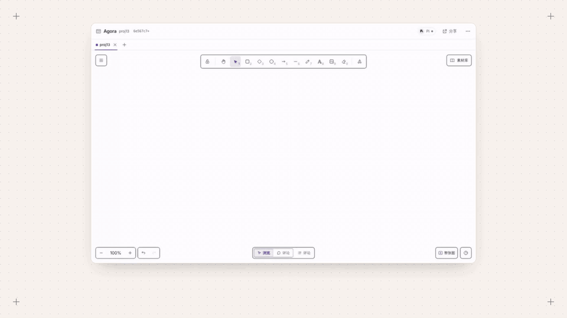
</p>

<p align="center"><sub>上面是 40 秒宣传片的片段，画面都取自 Agora 的实录；宣传片的源文件和构建脚本在 <a href="docs/promo/">docs/promo/</a>，成片不放进仓库。</sub></p>

## 它怎么工作

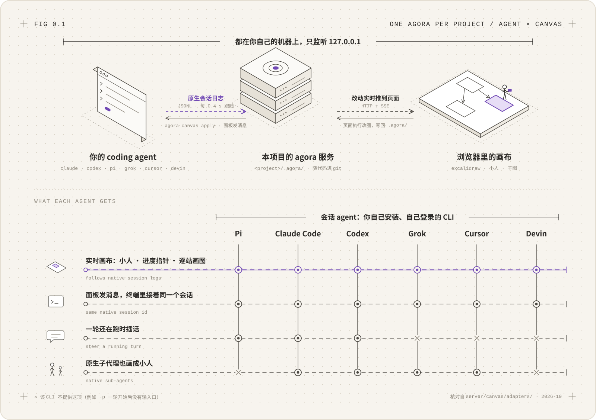

- 你在面板或终端里跟 agent 说话，它照常写自己的原生会话日志；本项目的 agora 服务每 0.4 秒跟随一次，把两边的轮次都推给页面。
- agent 通过 `agora` skill 调 `agora canvas read / apply / link / anim` 读图、改图。画布由页面持有：改图请求经服务转给页面执行（校验 schema、引用和新鲜度），结果写回 `.agora/`，每批修改都能撤销。
- 全部跑在你自己的机器上，服务只监听 `127.0.0.1`。分享时才经 Cloudflare Tunnel 开一个只读的访客入口。

会话 agent 有六个：**Pi、Claude Code、Codex、Grok、Cursor、Devin**。都能在画布上看到小人、进度指针和逐站画图，都能在面板发消息、在终端接着同一个会话。图下半部分的两处差别来自 CLI 本身：Grok、Cursor、Devin 的 `-p` 模式一轮开始后不接收输入，所以没法在一轮还在跑时插话；Pi 和 Devin 没有原生子代理。

## 选哪种方式

| 你想 | 用 |
|---|---|
| 在自己的项目里用 Agora | [安装成全局命令](#安装成全局命令)，然后在项目目录里敲 `agora` |
| 改 Agora 本身 | [从源码运行](#从源码运行)，或 `uv tool install --editable ~/code/agora` 一边改一边在别的项目里用 |
| 把一张图给别人看、让他评论 | [分享](#分享给别人看)：`agora share create --for 1d` 开一个只读地址 |

## 快速开始

依赖：

| 依赖 | 用途 |
|---|---|
| [uv](https://docs.astral.sh/uv/)（Python 3.12+，没有时 uv 自己装） | 安装和运行 `agora` 命令 |
| Node 22+ 与 npm（从源码安装或开发时；开发用 Node 24，写在 `web/mise.toml`，装了 [mise](https://mise.jdx.dev) 会自动选用） | 构建前端 |
| tmux | 「在终端打开」 |
| 至少一个已登录的 agent CLI：`pi`、`claude`、`codex`、`grok`、`cursor-agent` 或 `devin` | 会话 |
| 可选：`cf`（没装时自动用 `npx cf@1.0.0-beta.5`，`AGORA_CF_VERSION` 可改；先 `npx cf auth login`）+ 自己的 Cloudflare 域名 | 分享 |

### 安装成全局命令

不需要留着仓库：

```bash
uv tool install git+https://github.com/arvakme/agora     # 安装时构建前端，需要 Node 和 npm

cd ~/code/my-service                  # 你的项目（.agora/ 建在当前目录）
agora                                 # 不带子命令等于 agora open：初始化 .agora/，起本项目服务并打开浏览器
agora open --no-browser               # 只起服务、打印地址
agora status                          # 在跑就打印地址、端口、pid
agora down                            # 停掉服务和本项目的 tmux
agora doctor [--fix]                  # 检查本机数据；--fix 从备份和本机注册表放回丢了的东西
```

- 装好后提示找不到 `agora`：运行一次 `uv tool update-shell` 再重开终端。`which agora` 能看到跑的是哪一份（以前把 `~/code/agora/bin` 加进过 `PATH` 的话，记得删掉）。
- 升级：`uv tool upgrade agora-canvas`（或重新 `uv tool install --force git+https://github.com/arvakme/agora`）。卸载：`uv tool uninstall agora-canvas`。
- 发行包名是 `agora-canvas`（PyPI 上 `agora`、`agora-cli` 都已被占用），命令名仍是 `agora`。推 `v*` 标签后，GitHub Release 里会有带好前端的 wheel，装它不需要 Node。**目前还没有发布过版本，也没有发布到 PyPI**；发布后可以 `uv tool install agora-canvas`，或不安装直接 `uvx --from agora-canvas agora open`。

首次打开会建一块以项目命名的空画布和一个会话。会话里的「画出这个项目的架构」按钮让推荐的 agent 看一遍项目、把架构画上去（也可以自己选 agent、自己写第一句话）；「看一个示例」会把示例图作为另一张画布打开。

### 从源码运行

开发 Agora 本身时用；改代码立即生效，还能走 vite 热更新：

```bash
git clone https://github.com/arvakme/agora.git ~/code/agora
cd ~/code/agora
uv sync
cd web && npm ci && npm run build && cd ..      # 用 mise 时：mise exec -- npm ci，以此类推

cd ~/code/my-service
~/code/agora/bin/agora open                     # 与上面的 agora 相同，跑的是这份仓库的代码
~/code/agora/bin/agora open --dev               # 前端走 vite 热更新（只有源码仓库能用）
```

一边改 Agora 一边在别的项目里用：`uv tool install --editable ~/code/agora`。全局的 `agora` 直接跑这份仓库的代码，改完不用重装，`agora open --dev` 也能用。

- `agora up` 只起服务并打印地址。从源码运行时把 `~/code/agora/bin` 加进 `PATH` 也能直接用 `agora`。
- 同时开着几个 worktree 的服务时，`agora dev status` 列出本机所有服务和各自跑的 git SHA（安装版显示包版本），`agora dev gc` 清掉已退出的记录。

### 分享给别人看

分享需要 `cf`（Cloudflare CLI；没装就用固定版本的 `npx cf`），并已 `npx cf auth login`（凭据归 `cf` 管，Agora 不存也不读）；`AGORA_SHARE_DOMAIN` 指定分享用的域名（账号里只有一个域名时可省）：

```bash
agora share create --for 1d        # 默认分享聚焦的画布；--canvas <id|名字>；--for 10m|2h|1d|7d|forever
agora share list
agora share revoke <id>            # 或 --all
```

没有 Cloudflare 账号也行：`agora share create --quick` 开一个临时 trycloudflare.com 地址。细节见下面的[分享](#6-分享给别人只读评论)。

## 核心能力

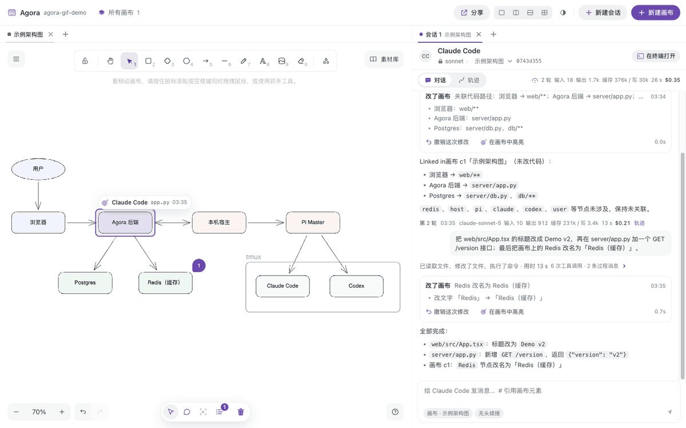

### 1. 一个项目一个 Agora，数据跟着代码走

`agora up` 在当前目录初始化 `.agora/` 并起本项目专属服务（只监听 `127.0.0.1`，不同项目各占一个端口）。画布是标准 `.excalidraw` 文件，评论是 JSON，键排序、内容不变就不重写，git diff 可读。会话记录、运行状态和分享记录默认不提交。格式见[项目存储](web/docs/project-storage.md)。

- 删除的画布和会话进「回收站」，30 天内可恢复（刷新、重启后也行）；「所有画布」底部还有「会话历史」，可以按时间、agent、主题、画布找会话，也能把本机找到的原生会话重新导入。
- 仓库移动、`cp -r` 复制、重新 clone 都有处理：移动后 Pi 会话的日志跟着挪；副本里的会话只读、可分叉继续；别的机器建的会话显示成只读卡片。`git clean -fdx` 删掉的本机数据（会话绑定、改图记录、回收站）由仓库外的每日备份和本机注册表兜底：`agora doctor --fix`。

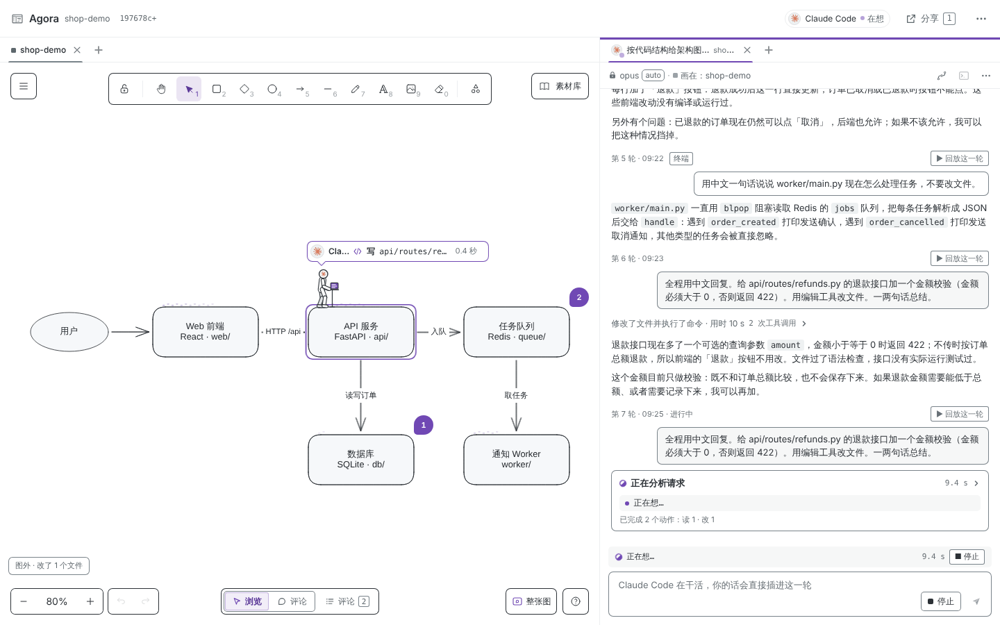

### 2. 你自己的 coding agent，平级、会话锁定

每个会话开始时选一个 agent，连同模型和强度一起锁定。会话就是这个 CLI 自己的原生会话，Agora 不另存对话，而是跟随 CLI 的会话日志。画布上的评论可以直接「交给 Agent」，答复会贴回评论线程。见 [Agent 会话](web/docs/agent-sessions.md)。

绑定会话时会自动为该 agent 安装 `agora` skill（旧的 `agora-canvas` 链接会被换掉）；也可以手动 `agora skill install --agent <agent>|all`（例如 Claude Code 链接到 `.claude/skills/`，Codex 链接到 `.agents/skills/`，Pi 每次启动带 `--skill`；链接写进 `.git/info/exclude`，不改全局配置）。

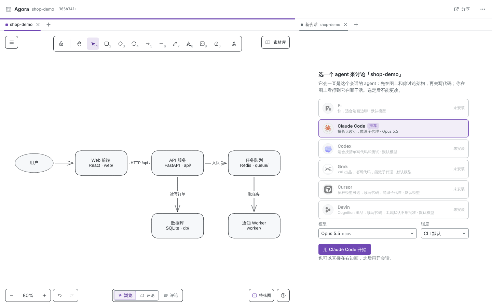

### 3. 一键在终端继续，双向同步

「在终端打开」用同一个原生会话 id 起交互式 CLI（比如 `claude --resume`、`pi --session-id`、`codex resume`），在本项目专属的 tmux 服务器里起，再用 Ghostty（没有就 Kitty，再没有就 Terminal.app）打开窗口。你在终端里说的话、agent 的回复和工具调用都会出现在面板上；从面板发的消息会等 agent 这一轮结束、且没有人占着终端的输入（接管了，或挂着一个可写窗口）时粘贴进去，队列不丢。

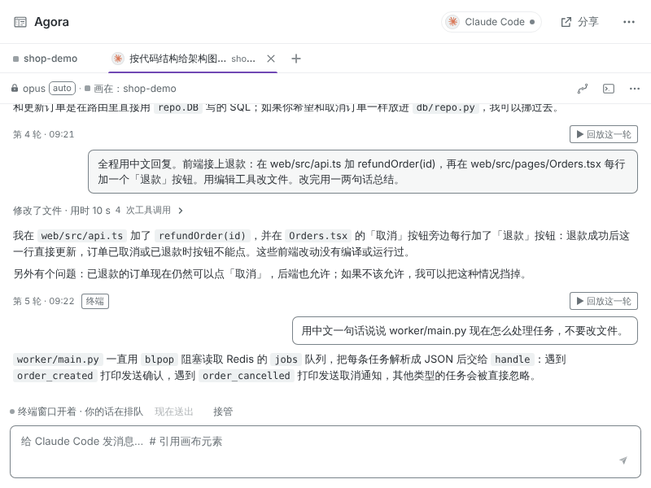

### 4. 进度指针：AI 正在改架构图的哪一块

给节点关联代码路径（glob，存在元素的 `customData.codePaths` 里，随图提交），可以手动设，也可以让 agent 按目录结构批量关联。agent 读写哪个文件，它的小人就走到这个文件所属的节点上干活（小人就是指针，见[工位视图](web/docs/workstation.md)；两个节点之间有箭头直接相连时，小人沿箭头滑过去，否则蹲下、沿抛物线跳过去）；不属于任何节点的文件在图外托盘。终端里发生的改动同样驱动它。映射规则见[进度指针](web/docs/progress-pointer.md)。

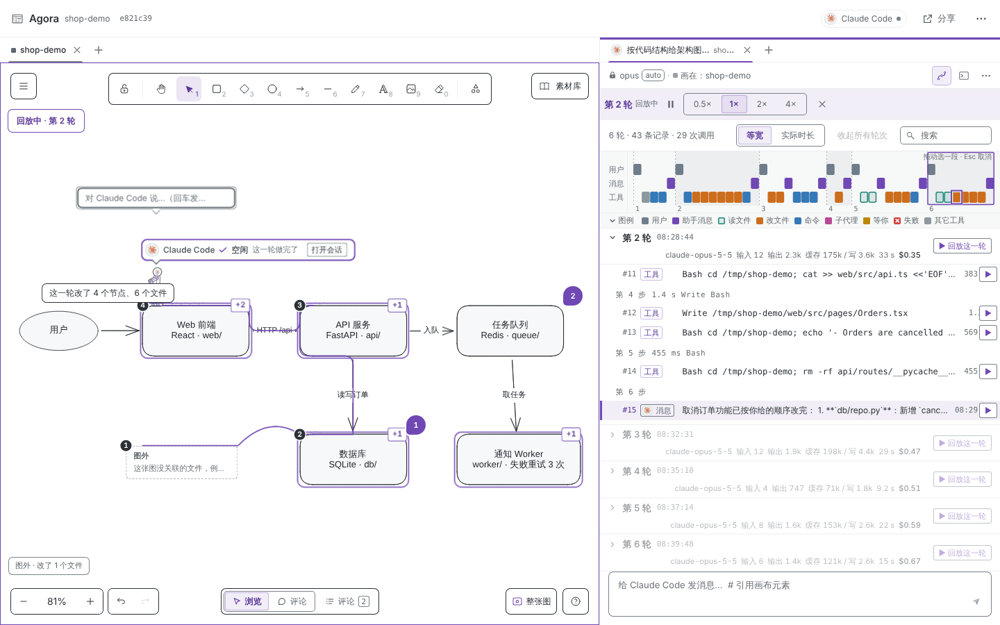

### 5. 轨迹逐步可查

「对话 / 轨迹」两种视图（信息结构取自 DeepSeek Harness）：每轮的模型、强度、输入 / 输出 / 缓存 tokens、耗时、花费；时间轴总览；每次工具调用可展开看完整输入、输出、改到的文件和起止时间。

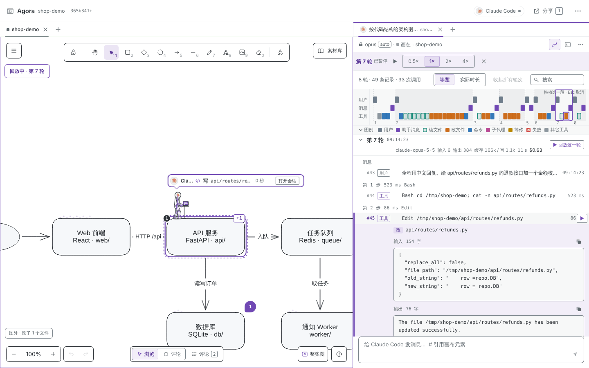

### 6. 分享给别人只读评论

`agora share create --for 1d`（或顶栏「分享」）经 Cloudflare Tunnel 给一块画布（或 `--whole-project` 整个项目，之后新建的画布也自动可见）开一个独立子域名，访客只能看图、读评论、发评论和回复；改图、会话、终端、代码路径和本地路径都不下发。到期或撤销后 DNS 记录和隧道一起删除。域名来自你自己的 Cloudflare zone（作者本机用的是 `quietharbor.de`）。没有账号也行：`agora share create --quick` 用 `cf tunnels quick-start` 开一个临时 trycloudflare.com 地址（一次一个分享，撤销或 `agora down` 即失效）。想把画布交给别的开发者：`agora share export` 导出分享包（访客页也有「导入到我的 Agora」），对方 `agora import` 就成了他项目里的新画布，评论作为只读历史；**分享包一旦给出去就收不回来**。见[分享](web/docs/sharing.md)。

| 作者：选画布和有效期 | 访客：只读画布，可评论 |
|---|---|
| 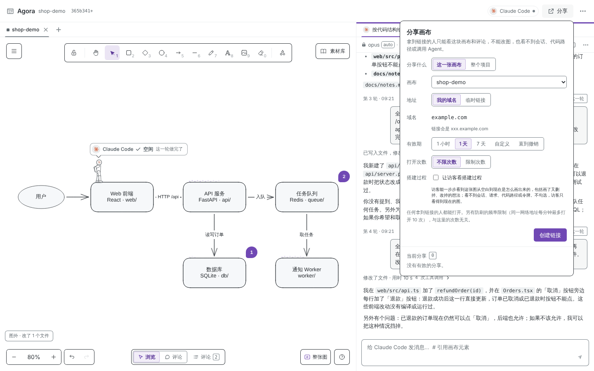 | 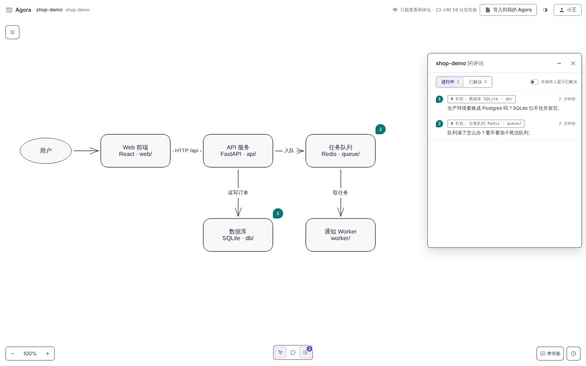 |

### 架构细节

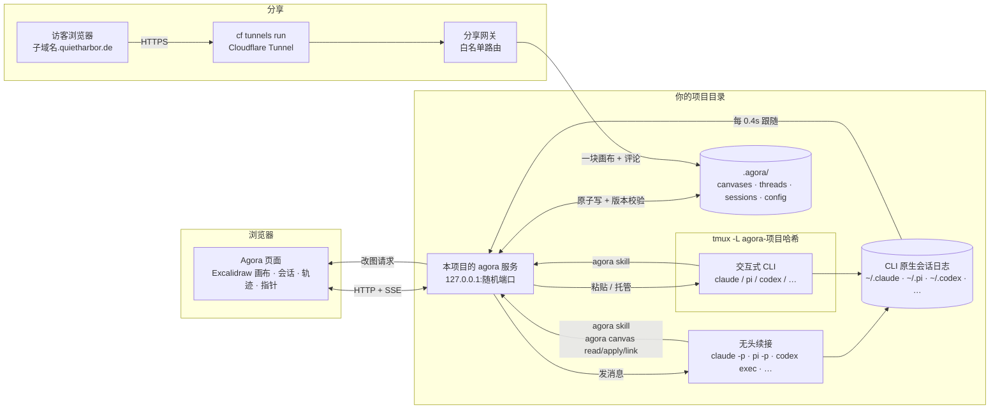

- 画布由页面持有：`agora canvas apply` 经服务转给最近连接的页面执行（校验 schema、引用和新鲜度），结果写回 `.agora/`。
- 对话以 CLI 自己的会话日志为准；服务跟随日志，把终端和面板两边的轮次都推给页面。
- 分享网关只通到被分享的那一块画布和它的评论；作者自己的应用不在隧道后面。

## 常见问题

**Agora 会把我的代码或对话传到别处吗？**
不会。服务只监听 `127.0.0.1`，对话就是 CLI 自己的会话日志，Agora 只读不另存。只有你主动 `agora share create` 时，被分享的那块画布和它的评论才经 Cloudflare Tunnel 对外，改图、会话、终端、代码路径和本地路径都不下发。

**要用哪家的模型？Agora 自己带 agent 吗？**
不带。会话用的是你本机已经装好、登录好的 CLI（Pi、Claude Code、Codex、Grok、Cursor、Devin 任一），模型和费用都走那个 CLI 自己的账号。

**`.agora/` 要不要提交？**
画布（`.excalidraw`）和评论（JSON）设计成可以提交，diff 可读；会话记录、运行状态和分享记录默认不提交。

**没开浏览器时 agent 能改图吗？**
不能。改图、关联代码、动画都由页面执行；只开终端、没开页面时 `agora canvas apply` 返回退出码 3。

**能多人同时编辑吗？**
不能，目前是单人编辑，冲突靠版本校验发现，由你选择载入磁盘版本或覆盖。别人可以通过分享地址看图和评论。

**支持 Linux / Windows 吗？**
只在 macOS 上实测过。没有 Ghostty、Kitty 或 Terminal.app 时，面板会给出 `tmux attach` 命令，在任意终端里都能接上。

**为什么包名叫 `agora-canvas`？**
PyPI 上 `agora` 和 `agora-cli` 都已被占用。命令名仍是 `agora`。包目前还没有发布到 PyPI，先用上面的 `uv tool install git+https://github.com/arvakme/agora`。

## 评测

固定的 7 类改图任务，每类跑 3 次，逐次检查：通过 schema 校验、新鲜度、改对元素、没有误伤、撤销后完全还原。最近一次（2026-09-28，`claude-sonnet-5`）：

| 任务 | 通过 | 平均耗时 | 平均花费 |
|---|---|---|---|
| T1 改名 | 3/3 | 5.7 s | $0.0088 |
| T2 新增节点并连线 | 3/3 | 8.7 s | $0.0092 |
| T3 给箭头加标签 | 3/3 | 4.6 s | $0.0039 |
| T4 对齐两个节点 | 3/3 | 26.2 s | $0.0232 |
| T5 删除节点并重连 | 3/3 | 4.8 s | $0.0050 |
| T6 从素材库插入 Kafka | 3/3 | 18.9 s | $0.0213 |
| T7 画一个普通 TODO 方框 | 3/3 | 6.3 s | $0.0057 |
| **合计** | **21/21（100%）** | **10.7 s** | **$0.0110（总 $0.2312）** |

评测基线是一次性的 `claude -p --json-schema`，在**中性的空临时目录**里运行，不继承仓库或项目上下文，也不经过 Agent 会话，只衡量「看图 + 评论 → 类型化改图操作」这一步。明细见 [web/eval/latest-report.md](web/eval/latest-report.md)，原始记录在 `web/eval/runs/`。

```bash
cd web
npm run eval -- --runs 3     # 真模型，写 eval/runs/*.jsonl 与 eval/latest-report.md
npm run eval:replay          # 离线回放最近一轮的模型输出（validate → apply → check → undo），不调模型
```

## 项目结构

```
agora_cli/            agora 命令：init / up / open / status / down / canvas / skill / share
bin/agora             在任意项目目录里调用上面的命令：源码仓库里经 uv run --project <仓库>，安装版里用安装环境自己的 Python
bin/agora-state       CLI 钩子向服务回报状态的脚本
server/canvas/        本项目服务：项目存储、六个 agent 后端、会话跟随与终端、画布桥接、分享与网关
server/paths.py       非 Python 文件（前端、素材库、skill、bin/）的唯一定位：源码里是仓库根，安装后是包内 server/_bundle/
hatch_build.py        打包钩子：没有 web/dist 时先构建，再把上述文件放进 wheel
skills/agora/         给各会话 agent 的 skill：SKILL.md 是入口路由，references/ 按领域放细节（改图、动画、子图、关联代码、评论、派活）
web/                  前端（React + Excalidraw）；web/docs/ 是各功能规格，web/eval/ 是评测
web/libraries/        vendored 素材库（约 6k 个组件，来源与许可见其 NOTICE.md）
tests/                Python 测试
docs/                 开发协作与测试说明；docs/assets/ 是 README 的横幅（banner-ink.svg 是墨迹洇开的动画版，banner.png 是静态版）和示意图，都带生成源文件，docs/promo/ 是宣传片源文件
```

## 限制

- **单人编辑。** 没有实时多人协同。同一项目开多个窗口，或在编辑器 / git 里改了 `.agora/` 文件，靠版本校验发现冲突，由你选择载入磁盘版本或覆盖；外部改动不会主动推送到已打开的页面。
- **写图需要打开的页面。** 改图、关联代码、动画都由页面执行；只开终端、没开页面时 `agora canvas apply` 返回退出码 3。
- **访客只能评论。** 不能改图、不能标记解决、不能交给 Agent。分享依赖你自己的 Cloudflare 账号和域名；刚删掉的子域名在别人的 DNS 缓存里可能还会留几分钟（返回 530）。
- **一轮 30 分钟没有任何输出会被中止。** 只看静默，不看总时长：一直有输出的轮、有工具调用在跑的轮（放宽到 2 小时）都不受这条限制；另有 6 小时总时长的保险丝。中止后原生会话还在，面板上点「继续」接着跑。`AGORA_TURN_IDLE_TIMEOUT_S` / `AGORA_TURN_MAX_S` 改秒数，0 = 不设。
- **终端里仍能换模型。** 锁定只管 Agora 这一侧，终端里的 `/model` 无法禁止（Pi 用 `--models` 把轮换限制在选定模型）；下一次无头续接仍按绑定的模型启动。
- **终端投递的边角。** 首次进入不信任的目录时 CLI 会先问是否信任，需要在终端里回答；输入框里留着没发出的半句话时，面板投递的消息会接在后面。
- **Codex 终端先行时靠认领。** 还没有原生 id 的 Codex 会话在终端里开新会话，Agora 认领打开终端之后同目录下出现的第一个 rollout；同一时间在同一目录另起 Codex 可能认错。
- **用量不全。** Claude Code 终端里的轮次没有花费（原生日志不记），Codex 不记花费。
- **指针只看编辑工具的写入。** `sed -i`、`cat > x` 这类 shell 写入不会被识别；读文件、跑测试不移动指针；一个文件只属于最具体的那个节点。
- **只在 macOS 上实测过。** 终端窗口用 Ghostty、Kitty 或 Terminal.app 打开（按这个顺序找已安装的，环境变量 `AGORA_TERMINAL=ghostty|kitty|terminal|auto` 可指定）；都没有时面板给出 `tmux attach` 命令；下拉里的「复制打开命令」给出可在任意终端里运行的命令。

可能的方向（未排期）：多人实时协同编辑、Linux 上的终端窗口、进度指针识别更多写入方式。

## 开发

```bash
uv run pytest tests/test_project_store.py tests/test_agent_sessions.py tests/test_share.py   # 画布相关，免外部服务
cd web && npx tsc -p . && npx vitest run && npm run build && npm run eval:replay
```

打包：`uv build` 在 `dist/` 生成 sdist 和 wheel（没有 `web/dist` 时先在 `web/` 里 `npm ci && npm run build`；`AGORA_SKIP_WEB_BUILD=1` 跳过前端）。推 `v*` 标签时 `.github/workflows/release.yml` 构建并附到 GitHub Release，不发布到 PyPI。

仓库目前不跑 CI，提交前在本地跑上面的检查；`.github/workflows/test.yml` 还在（全部 Python 测试，以及前端的类型检查、单测、构建、离线评测回放和素材库校验），需要时在 GitHub 上重新启用 Actions 即可。开发协作见 [docs/development.md](docs/development.md)，测试说明见 [docs/testing.md](docs/testing.md)，后端编排（Agent 生命周期、派发与恢复）见 [docs/orchestration.md](docs/orchestration.md)，一页面试讲法见 [docs/orchestration-interview.md](docs/orchestration-interview.md)。

## 许可与致谢

本项目以 [MIT](LICENSE) 许可发布。第三方内容：

- **Excalidraw**（MIT）：画布编辑器。
- **素材库**（`web/libraries/`）：来自 excalidraw-libraries 等来源的组件。各自的作者、许可和原始地址见 [NOTICE.md](web/libraries/NOTICE.md) 与 [SOURCES.md](web/libraries/SOURCES.md)，许可全文在 `web/libraries/licenses/`。其中的产品名称和标志归各自所有者，仅用于在图中指代对应产品。
- **Dither Icons**（[`@unlocalhosted/dither-icons`](https://dithered.dev)，MIT，© 2026 Unlocalhosted）：界面图标。
- **dither-extra 图标**（`web/src/app/dither-extra/`）：本项目作者为 Marginalia 按 Dither Icons 的构造规则绘制的 17 个补充图标（`eye-off` 复用 Dither Icons 的眼睛几何），随本项目以 MIT 发布，并附 Dither Icons 的许可原文（[LICENSE-dither-icons.txt](web/src/app/dither-extra/LICENSE-dither-icons.txt)）。
- **DeepSeek Harness**（github.com/deepseek-ai/deepseek-harness，MIT）：会话「对话 / 轨迹」视图的信息结构，用本项目的技术栈重写，未引入其依赖。
- **Agent 标志**（`web/src/app/agents/`，随应用打包、不在运行时外链）：Pi 取自 [pi.dev](https://pi.dev) Press Kit 的方形徽标（Badge SVG，`pi.dev/favicon.svg`，单色，亮色 `#111111`、暗色 `#f6f6f6`），以矢量路径内联；Claude Code 取自官方文档站 [code.claude.com/docs](https://code.claude.com/docs) 的矢量标志（橙色星芒 `#D97757`），以矢量路径内联；Codex 取自 OpenAI 签名的 Codex 桌面应用（bundle id `com.openai.codex`，26.908.70816）自带的 1024px 图标 `Contents/Resources/icon-codex-light.png` 与 `icon-codex-dark-color.png`：用两张图做差分抠图去掉应用底板与投影，只留中间的云形标志，导出 64px 与 128px 两档；Grok 取自 xAI 官网 [x.ai](https://x.ai) 自己发布的站点图标 `https://x.ai/icon.png`（512px 位图，黑底白标；官方没有公开矢量，`grok.com` 拒绝抓取），2026-09-29 取得，缩成 64px 与 128px 两档；Cursor 取自 [cursor.com](https://cursor.com) 的 `https://cursor.com/favicon.svg`（矢量，自带深色圆角底板 `#14120b` 与浅色立方体 `#edecec`，两种主题下原样使用，以矢量路径内联），2026-09-29 取得；Devin 取自 [devin.ai](https://devin.ai) 的 `https://devin.ai/favicon.svg`（单色矢量，原色黑 `#000000`，内联时改用主题墨色：亮色 `#111111`、暗色 `#f6f6f6`），2026-09-29 取得。
- **终端应用图标**（`web/src/app/terminals/`）：Kitty 取自本机 `kitty.app`（0.48.2）的 `Contents/Resources/kitty.icns`，Kitty 为 Kovid Goyal 的作品（[kovidgoyal/kitty](https://github.com/kovidgoyal/kitty)）；取 32px 与 64px 两档，未改动图形。
- **以上标志和图标是各自所有者（Earendil / Pi、Anthropic、OpenAI、xAI、Anysphere / Cursor、Cognition / Devin、Kovid Goyal / kitty）的商标或作品，不在本项目的 MIT 许可范围内，这里仅用于标识对应的产品；本项目与它们没有从属或背书关系。**
