<p align="center">
  
</p>

<p align="center">
  <a href="README.md"></a>
  <a href="README.zh-CN.md"></a>
</p>

<h1 align="center">Agora</h1>

<p align="center"><b>Every project gets its own Agora: talk the design through with your own coding agent on the project's architecture diagram, then pick up the very same session in the terminal.</b></p>

<p align="center">
  <a href="https://arvakme.github.io/agora/"></a>
  <a href="LICENSE"></a>
</p>

Type `agora` in a project directory and your browser opens an architecture diagram that belongs to that project alone. Ask the agent to change code and its little figure walks to the matching node on the diagram to work there; ask it to change the diagram and it draws it station by station. Diagrams, comments and session records live in the project's `.agora/`, so they are committed, cloned and branched along with the code. Sessions stay the CLI's own native sessions: Agora follows their logs and never keeps a second copy of the conversation.

<p align="center">
  <a href="docs/media/agora-promo.en.mp4">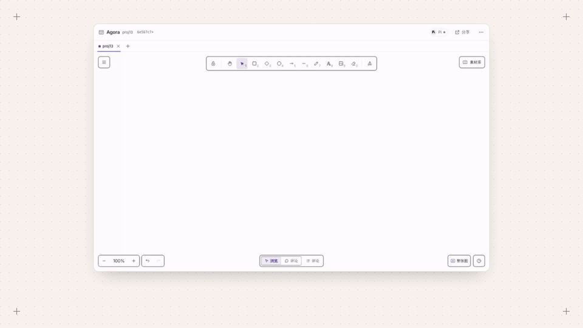</a>
</p>

> The UI comes in English and Chinese. It follows your browser language; switch it in the top bar’s View and layout menu.

## How it works


- You talk to the agent in the panel or in the terminal, and it writes its own native session log as usual; this project's agora service follows that log every 0.4 s and pushes turns from both sides to the page.
- The agent reads and edits the diagram through the `agora` skill, which calls `agora canvas read / apply / link / anim`. The page owns the canvas: edit requests go through the service to the page, which validates schema, references and freshness, writes the result back to `.agora/`, and makes every batch undoable.
- Everything runs on your own machine, and the service listens on `127.0.0.1` only. A read-only guest entrance is opened through Cloudflare Tunnel only when you share.

There are six session agents: **Pi, Claude Code, Codex, Grok, Cursor and Devin**. All of them get the figure on the canvas, progress pointers and station-by-station drawing, and all can be messaged from the panel and continued in the terminal. The two differences at the bottom of the figure come from the CLIs themselves: the `-p` modes of Grok, Cursor and Devin take no input once a turn has started, so you can't interject mid-turn; Pi and Devin have no native sub-agents.

Running, it looks roughly like this: three agents each run turn after turn, the service follows their native logs and pushes changes to the canvas; on the right is what happens only when you click. Turn counts and turn ids are illustrative; the states `pending → in_flight → accepted → completed` are the real states Agora records for each turn.

<p align="center">
  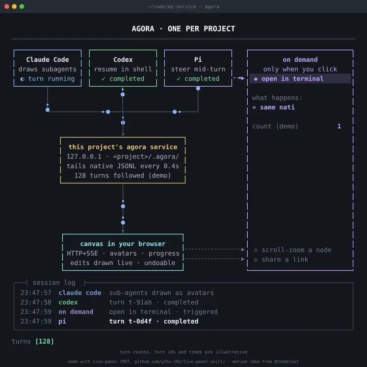
</p>

## Which way to use it

| You want to | Use |
|---|---|
| Use Agora in your own projects | [Install it as a global command](#install-as-a-global-command), then type `agora` in a project directory |
| Work on Agora itself | [Run from source](#run-from-source), or `uv tool install --editable ~/code/agora` to use it in other projects while you change it |
| Show a diagram to someone and let them comment | [Share it](#share-it-with-others): `agora share create --for 1d` opens a read-only address |

## Quick start

Requirements:

| Requirement | For |
|---|---|
| [uv](https://docs.astral.sh/uv/) (Python 3.12+, uv installs it if missing) | Installing and running `agora` |
| Node 22+ and npm (when installing from source or developing; development uses Node 24, pinned in `web/mise.toml` and picked up automatically by [mise](https://mise.jdx.dev)) | Building the front end |
| tmux | "Open in terminal" |
| At least one signed-in agent CLI: `pi`, `claude`, `codex`, `grok`, `cursor-agent` or `devin` | Sessions |
| Optional: `cf` (falls back to `npx cf@1.0.0-beta.5` when missing, override with `AGORA_CF_VERSION`; run `npx cf auth login` first) plus your own Cloudflare domain | Sharing |

### Install as a global command

You don't need to keep the repository around:

```bash
uv tool install git+https://github.com/arvakme/agora     # builds the front end at install time; needs Node and npm

cd ~/code/my-service                  # your project (.agora/ is created in the current directory)
agora                                 # same as agora open: initialise .agora/, start this project's service, open the browser
agora open --no-browser               # start the service and print the address only
agora status                          # if running, print address, port and pid
agora down                            # stop the service and this project's tmux
agora doctor [--fix]                  # check local data; --fix restores missing pieces from backups and the local registry
```

- If `agora` isn't found after installing, run `uv tool update-shell` once and reopen the terminal. `which agora` shows which copy runs (if you once added `~/code/agora/bin` to `PATH`, remove it).
- Upgrade: `uv tool upgrade agora-canvas` (or reinstall with `uv tool install --force git+https://github.com/arvakme/agora`). Uninstall: `uv tool uninstall agora-canvas`.
- The distribution is called `agora-canvas` (`agora` and `agora-cli` are taken on PyPI); the command is still `agora`. Pushing a `v*` tag attaches a wheel with the front end prebuilt to the GitHub Release, which installs without Node. **No version has been released yet, and nothing is on PyPI.** Once it is, `uv tool install agora-canvas` will work, or `uvx --from agora-canvas agora open` without installing.

The first open creates an empty canvas named after the project and one session. The session's "Draw this project's architecture" button lets the recommended agent look through the project and draw its architecture (you can also pick the agent and write the first message yourself); "See an example" opens the example diagram as a separate canvas.

### Run from source

For working on Agora itself; code changes apply immediately, and the front end can run on vite hot reload:

```bash
git clone https://github.com/arvakme/agora.git ~/code/agora
cd ~/code/agora
uv sync
cd web && npm ci && npm run build && cd ..      # with mise: mise exec -- npm ci, and so on

cd ~/code/my-service
~/code/agora/bin/agora open                     # same as agora above, running this repository's code
~/code/agora/bin/agora open --dev               # front end on vite hot reload (source checkout only)
```

To use Agora in other projects while changing it: `uv tool install --editable ~/code/agora`. The global `agora` then runs this repository's code directly, with no reinstall after changes, and `agora open --dev` works too.

- `agora up` only starts the service and prints the address. When running from source, adding `~/code/agora/bin` to `PATH` also gives you `agora` directly.
- With services running from several worktrees at once, `agora dev status` lists every service on the machine and the git SHA each runs (installed copies show the package version); `agora dev gc` clears records of services that have exited.

### Share it with others

Sharing needs `cf` (the Cloudflare CLI; a pinned `npx cf` is used when it isn't installed) and a prior `npx cf auth login` (credentials belong to `cf`; Agora neither stores nor reads them). `AGORA_SHARE_DOMAIN` sets the domain to share on (optional when the account has only one):

```bash
agora share create --for 1d        # shares the focused canvas by default; --canvas <id|name>; --for 10m|2h|1d|7d|forever
agora share list
agora share revoke <id>            # or --all
```

No Cloudflare account? `agora share create --quick` opens a temporary trycloudflare.com address. Details under [sharing](#6-read-only-sharing-with-comments) below.

## Features

### 1. One Agora per project, data travels with the code

`agora up` initialises `.agora/` in the current directory and starts a service just for this project (listening on `127.0.0.1` only, one port per project). Canvases are standard `.excalidraw` files and comments are JSON, with sorted keys and no rewrite when content is unchanged, so git diffs stay readable. Session records, run state and share records are not committed by default. Format: [project storage](web/docs/project-storage.md).

- Deleted canvases and sessions go to the trash and can be restored for 30 days (across reloads and restarts too). At the bottom of "All canvases" there's "Session history", where you can find sessions by time, agent, topic or canvas, and re-import native sessions found on this machine.
- Moving the repository, copying it with `cp -r` or cloning it again are all handled: after a move, Pi session logs move along; sessions in a copy are read-only and can be forked to continue; sessions created on another machine show as read-only cards. Local data wiped by `git clean -fdx` (session bindings, edit records, trash) is backed by a daily backup outside the repository and a local registry: `agora doctor --fix`.

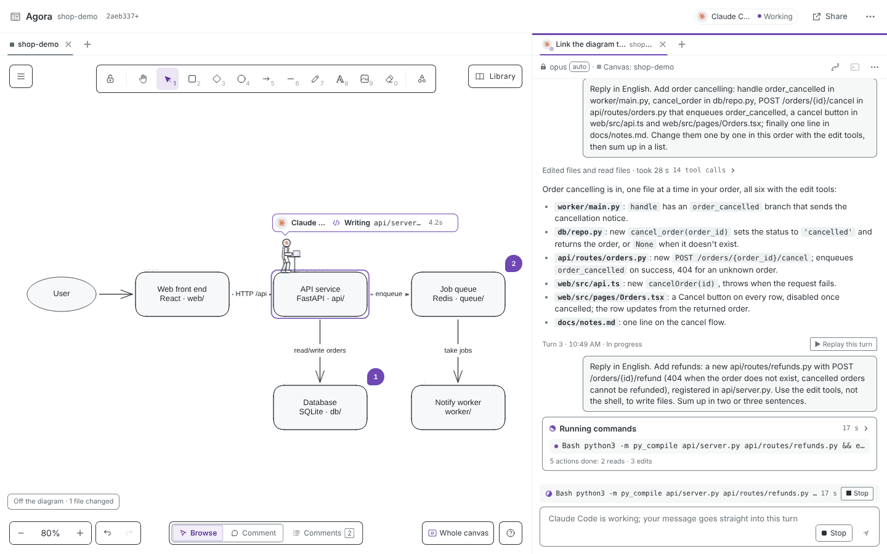

### 2. Your own coding agent, side by side, session-locked

Each session picks an agent when it starts, locked together with its model and effort. The session is that CLI's own native session; Agora keeps no separate conversation and follows the CLI's session log instead. A comment on the canvas can be "handed to the agent", and the answer is posted back into the comment thread. See [agent sessions](web/docs/agent-sessions.md).

Binding a session installs the `agora` skill for that agent automatically (an old `agora-canvas` link is replaced); you can also run `agora skill install --agent <agent>|all` by hand (for example Claude Code links into `.claude/skills/`, Codex into `.agents/skills/`, and Pi gets `--skill` on every launch; links are written to `.git/info/exclude`, and no global config is changed).

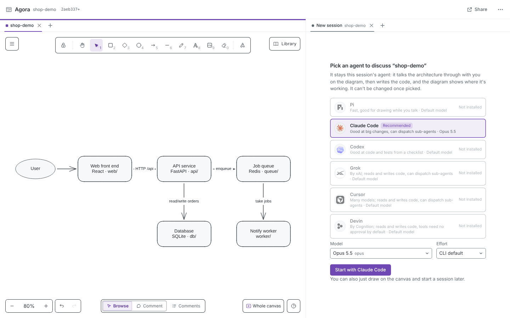

### 3. Continue in the terminal in one click, synced both ways

"Open in terminal" starts the interactive CLI on the same native session id (for example `claude --resume`, `pi --session-id`, `codex resume`) inside this project's own tmux server, then opens a window in Ghostty (or Kitty, or Terminal.app). What you say in the terminal, the agent's replies and its tool calls all show up in the panel; messages sent from the panel wait until the agent's turn ends and nobody holds the terminal's input (taken over, or a writable window attached), then get pasted in. The queue never drops anything.

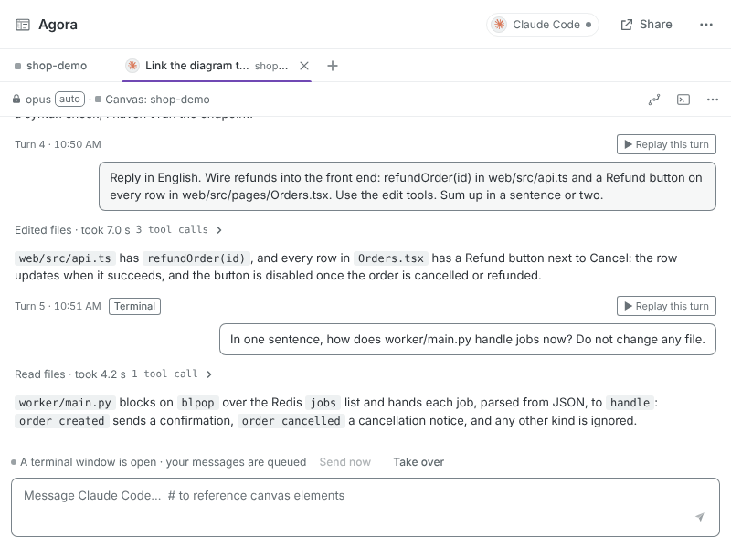

### 4. Progress pointer: which part of the architecture the AI is changing

Link nodes to code paths (globs, stored in the element's `customData.codePaths` and committed with the diagram), by hand or by letting the agent link them in bulk from the directory layout. Whatever file the agent reads or writes, its figure walks to the node that file belongs to (the figure is the pointer, see [workstation view](web/docs/workstation.md); when two nodes are joined by an arrow it glides along the arrow, otherwise it crouches and hops over on a parabola). Files that belong to no node are listed under the “off the diagram” chip. Changes made in the terminal drive it the same way. Mapping rules: [progress pointer](web/docs/progress-pointer.md).

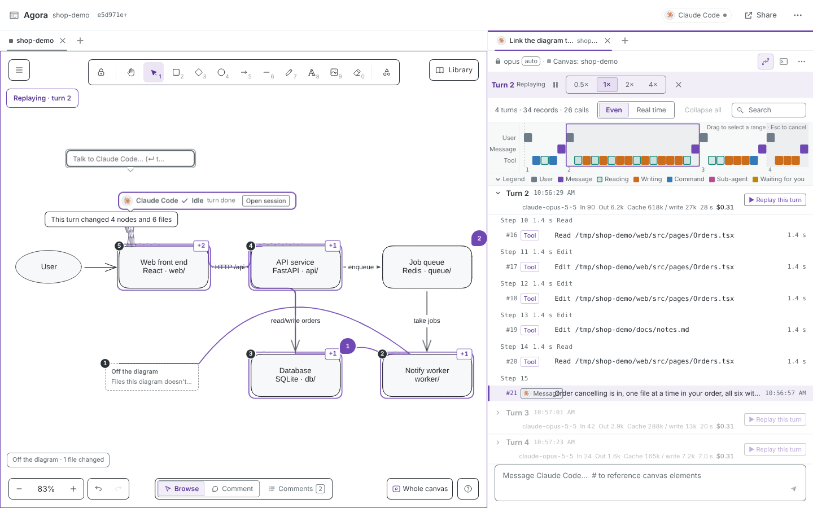

### 5. Step-by-step trajectories

Two views, "Conversation / Trajectory" (information structure taken from DeepSeek Harness): model, effort, input / output / cached tokens, duration and cost per turn; a timeline overview; and every tool call expands to its full input, output, changed files and start and end times.

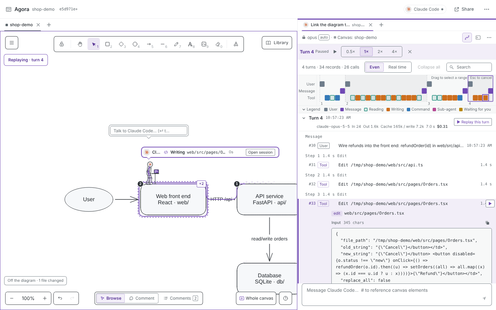

### 6. Read-only sharing with comments

`agora share create --for 1d` (or "Share" in the top bar) opens a dedicated subdomain through Cloudflare Tunnel for one canvas (or `--whole-project` for the whole project, including canvases created later). Guests can only view the diagram, read comments, comment and reply; diagram editing, sessions, terminal, code paths and local paths are never sent. On expiry or revocation the DNS record and the tunnel are deleted together. The domain comes from your own Cloudflare zone (the author uses `quietharbor.de`). No account is fine too: `agora share create --quick` uses `cf tunnels quick-start` to open a temporary trycloudflare.com address (one share at a time, gone on revoke or `agora down`). To hand a canvas to another developer: `agora share export` writes a share bundle (the guest page also has "Import into my Agora"), and `agora import` on their side turns it into a new canvas in their project, with comments kept as read-only history. **A share bundle can't be taken back once given out.** See [sharing](web/docs/sharing.md).

| Author: pick a canvas and an expiry | Guest: read-only canvas, can comment |
|---|---|
| 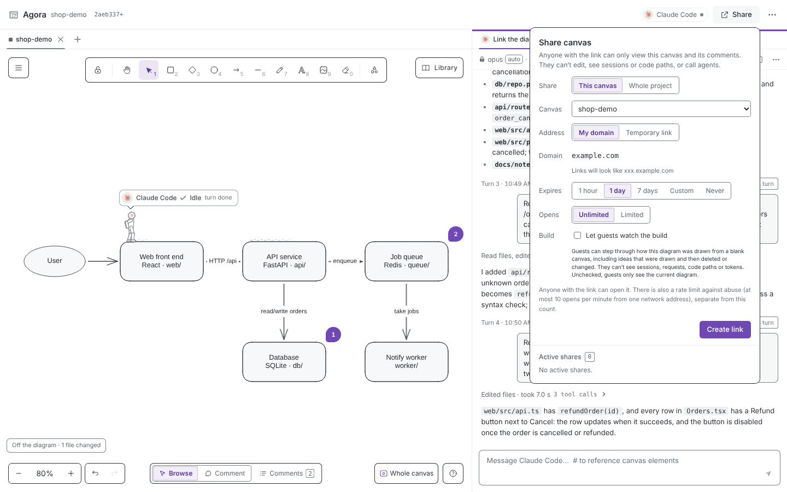 | 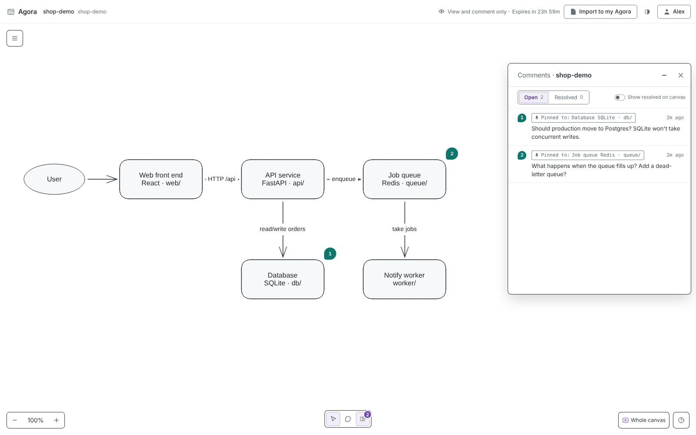 |

### Architecture in detail

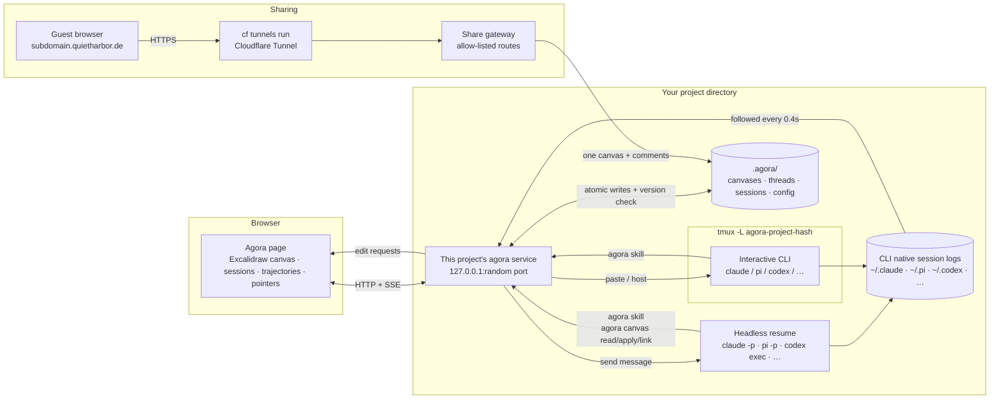

- The page owns the canvas: `agora canvas apply` goes through the service to the most recently connected page, which validates schema, references and freshness, and writes the result back to `.agora/`.
- The CLI's own session log is the source of truth for the conversation; the service follows it and pushes turns from both the terminal and the panel to the page.
- The share gateway reaches only the shared canvas and its comments; the author's own app is not behind the tunnel.

## FAQ

**Does Agora send my code or conversations anywhere?**
No. The service listens on `127.0.0.1` only, and the conversation is the CLI's own session log, which Agora reads without keeping a copy. Only when you run `agora share create` does the shared canvas, with its comments, go out through Cloudflare Tunnel; diagram editing, sessions, terminal, code paths and local paths are never sent.

**Which model provider does it need? Does Agora ship its own agent?**
No. Sessions use a CLI already installed and signed in on your machine (any of Pi, Claude Code, Codex, Grok, Cursor, Devin), and models and costs go through that CLI's own account.

**Should `.agora/` be committed?**
Canvases (`.excalidraw`) and comments (JSON) are designed to be committed with readable diffs; session records, run state and share records are not committed by default.

**Can the agent edit the diagram with no browser open?**
No. Diagram edits, code links and animations are carried out by the page; with only the terminal open, `agora canvas apply` exits with code 3.

**Can several people edit at once?**
No, editing is single-user for now. Conflicts are caught by a version check, and you choose whether to load the disk version or overwrite. Others can view and comment through a share address.

**Linux / Windows?**
Day-to-day use has been on macOS; Linux desktops are supported too (the test suite runs on Linux). Without a terminal Agora knows how to open (Ghostty, Kitty, Terminal.app; on Linux also GNOME Terminal, Konsole, WezTerm, Alacritty, xterm), the panel gives you a `tmux attach` command that works in any terminal.

**Why is the package called `agora-canvas`?**
`agora` and `agora-cli` are taken on PyPI. The command is still `agora`. The package isn't on PyPI yet; use `uv tool install git+https://github.com/arvakme/agora` above for now.

## Evaluation

Seven fixed kinds of diagram edit, three runs each, every run checked for: passing schema validation, freshness, changing the right elements, no collateral damage, and an undo that restores everything. Latest run (2026-09-28, `claude-sonnet-5`):

| Task | Passed | Avg. time | Avg. cost |
|---|---|---|---|
| T1 Rename | 3/3 | 5.7 s | $0.0088 |
| T2 Add a node and connect it | 3/3 | 8.7 s | $0.0092 |
| T3 Label an arrow | 3/3 | 4.6 s | $0.0039 |
| T4 Align two nodes | 3/3 | 26.2 s | $0.0232 |
| T5 Delete a node and reconnect | 3/3 | 4.8 s | $0.0050 |
| T6 Insert Kafka from the library | 3/3 | 18.9 s | $0.0213 |
| T7 Draw a plain TODO box | 3/3 | 6.3 s | $0.0057 |
| **Total** | **21/21 (100%)** | **10.7 s** | **$0.0110 ($0.2312 total)** |

The baseline is a one-shot `claude -p --json-schema` run in a **neutral, empty temporary directory**, inheriting no repository or project context and not going through an agent session; it measures only the "diagram + comment → typed edit operations" step. Details in [web/eval/latest-report.md](web/eval/latest-report.md), raw records in `web/eval/runs/`.

```bash
cd web
npm run eval -- --runs 3     # real model; writes eval/runs/*.jsonl and eval/latest-report.md
npm run eval:replay          # replays the latest run's model output offline (validate → apply → check → undo), no model calls
```

## Project layout

```
agora_cli/            the agora command: init / up / open / status / down / canvas / skill / share
bin/agora             runs that command from any project directory: via uv run --project <repo> in a source checkout, with the install's own Python when installed
bin/agora-state       script CLI hooks use to report state to the service
server/canvas/        the per-project service: project storage, six agent back ends, session following and terminal, canvas bridge, sharing and gateway
server/paths.py       the single locator for non-Python files (front end, library, skill, bin/): repo root in source, server/_bundle/ inside the package when installed
hatch_build.py        packaging hook: builds web/dist if missing, then puts the files above into the wheel
skills/agora/         the skill for session agents: SKILL.md routes, references/ holds details by area (editing, animation, sub-diagrams, code links, comments, dispatch)
web/                  front end (React + Excalidraw); web/docs/ holds feature specs, web/eval/ the evaluation
web/libraries/        vendored asset library (about 6k components; sources and licenses in its NOTICE.md)
tests/                Python tests
docs/                 development conventions and testing notes; docs/assets/ holds the README banner (banner-ink.svg animated, banner.png static) and figures with their generator sources; docs/promo/ is the promo film source (renders in docs/media/agora-promo.en.mp4 and agora-promo.zh.mp4)
site/                 the website (Astro), English at / and Chinese at /zh
```

## Limitations

- **Single-user editing.** No real-time collaboration. Several windows on one project, or edits to `.agora/` files from an editor or git, are caught by the version check, and you choose whether to load the disk version or overwrite; outside changes aren't pushed to pages already open.
- **Diagram edits need an open page.** Diagram edits, code links and animations are carried out by the page; with only the terminal open, `agora canvas apply` exits with code 3.
- **Guests can only comment.** They can't edit the diagram, resolve threads or hand comments to the agent. Sharing depends on your own Cloudflare account and domain; a just-deleted subdomain can linger in other people's DNS caches for a few minutes (returning 530).
- **A turn with no output for 30 minutes is stopped.** Only silence counts, not total length: turns that keep producing output, and turns with a tool call running (relaxed to 2 hours), aren't affected; there's also a 6-hour total-length fuse. The native session survives a stop; click "Continue" in the panel to carry on. `AGORA_TURN_IDLE_TIMEOUT_S` / `AGORA_TURN_MAX_S` set the seconds, 0 = no limit.
- **The model can still be changed in the terminal.** The lock covers Agora's side only; `/model` in the terminal can't be blocked (Pi uses `--models` to limit cycling to the chosen model). The next headless resume still starts with the bound model.
- **Terminal delivery edge cases.** The first time a CLI enters an untrusted directory it asks whether to trust it, which you answer in the terminal; if a half-typed message sits in the input box, a message delivered from the panel is appended to it.
- **Codex started from the terminal is claimed.** A Codex session without a native id that starts a new session in the terminal claims the first rollout appearing in the same directory after the terminal opens; starting another Codex in the same directory at the same moment may claim the wrong one.
- **Usage is incomplete.** Claude Code turns from the terminal have no cost (the native log doesn't record it), and Codex records no cost.
- **The pointer only sees writes by edit tools.** Shell writes such as `sed -i` or `cat > x` aren't recognised; reading files or running tests doesn't move the pointer; a file belongs only to the most specific node.
- **Used day to day on macOS; Linux desktops are supported.** Terminal windows open in Ghostty, Kitty or Terminal.app, and on a Linux desktop (`DISPLAY` or `WAYLAND_DISPLAY` set) also GNOME Terminal, Konsole, WezTerm, Alacritty or xterm (first installed one in that order, or set `AGORA_TERMINAL` to one of `ghostty|kitty|terminal|gnome-terminal|konsole|wezterm|alacritty|xterm|auto`); with none, the panel gives a `tmux attach` command; "Copy open command" in the menu gives a command that runs in any terminal.

Possible directions (unscheduled): real-time multi-user editing, terminal windows on Linux, more UI languages, and more kinds of writes recognised by the progress pointer.

## Development

```bash
uv run pytest tests/test_project_store.py tests/test_agent_sessions.py tests/test_share.py   # canvas-related, no external services
cd web && npx tsc -p . && npx vitest run && npm run build && npm run eval:replay
```

Packaging: `uv build` writes an sdist and a wheel to `dist/` (run `npm ci && npm run build` in `web/` first if there's no `web/dist`; `AGORA_SKIP_WEB_BUILD=1` skips the front end). Pushing a `v*` tag makes `.github/workflows/release.yml` build and attach them to a GitHub Release; nothing is published to PyPI.

CI isn't running on the repository right now, so run the checks above locally before committing; `.github/workflows/test.yml` is still there (all Python tests plus front-end type check, unit tests, build, offline eval replay and library validation) and can be re-enabled in GitHub Actions when needed. Development conventions: [docs/development.md](docs/development.md); testing: [docs/testing.md](docs/testing.md); back-end orchestration (agent lifecycle, dispatch and recovery): [docs/orchestration.md](docs/orchestration.md). These docs are in Chinese.

## License and credits

This project is released under the [MIT](LICENSE) license. Third-party content:

- **Excalidraw** (MIT): the canvas editor.
- **live-panel** ([ythx-101/live-panel-skill](https://github.com/ythx-101/live-panel-skill), MIT): renders the "running" panel animation in this README (`docs/assets/live-panel*.json` are the configs; its code isn't in this repository, and its Smiley Sans font and Lucide icons aren't used). The panel's style and motion are learned from [@thedelost](https://x.com/thedelost/status/2105398038026195279).
- **Banner animation**: the ink reveal in `docs/assets/banner-ink.svg` borrows its technique from browser-use's banner-ink.svg ([browser-use/media](https://github.com/browser-use/media)); the picture and parameters are this project's own.
- **Asset library** (`web/libraries/`): components from excalidraw-libraries and other sources. Authors, licenses and original addresses are in [NOTICE.md](web/libraries/NOTICE.md) and [SOURCES.md](web/libraries/SOURCES.md), full license texts in `web/libraries/licenses/`. Product names and logos in it belong to their owners and are used only to refer to those products in diagrams.
- **Dither Icons** ([`@unlocalhosted/dither-icons`](https://dithered.dev), MIT, © 2026 Unlocalhosted): UI icons.
- **dither-extra icons** (`web/src/app/dither-extra/`): 17 extra icons drawn by this project's author for Marginalia following Dither Icons' construction rules (`eye-off` reuses Dither Icons' eye geometry), released with this project under MIT together with the Dither Icons license text ([LICENSE-dither-icons.txt](web/src/app/dither-extra/LICENSE-dither-icons.txt)).
- **DeepSeek Harness** (github.com/deepseek-ai/deepseek-harness, MIT): the information structure of the session "Conversation / Trajectory" views, rewritten in this project's stack without its dependencies.
- **Agent logos** (`web/src/app/agents/`, bundled with the app, never hot-linked at runtime): Pi from the square badge in the [pi.dev](https://pi.dev) press kit (badge SVG, `pi.dev/favicon.svg`, monochrome, `#111111` light and `#f6f6f6` dark), inlined as vector paths; Claude Code from the vector logo on the official docs site [code.claude.com/docs](https://code.claude.com/docs) (orange starburst `#D97757`), inlined as vector paths; Codex from the 1024 px icons `Contents/Resources/icon-codex-light.png` and `icon-codex-dark-color.png` shipped in OpenAI's signed Codex desktop app (bundle id `com.openai.codex`, 26.908.70816), difference-matted from the two images to remove the app tile and shadow, keeping only the cloud mark, exported at 64 px and 128 px; Grok from the site icon `https://x.ai/icon.png` published on xAI's own site [x.ai](https://x.ai) (512 px bitmap, white mark on black; no public vector, and `grok.com` refuses fetching), taken 2026-09-29 and scaled to 64 px and 128 px; Cursor from `https://cursor.com/favicon.svg` on [cursor.com](https://cursor.com) (vector with its own dark rounded tile `#14120b` and light cube `#edecec`, used as-is in both themes, inlined as vector paths), taken 2026-09-29; Devin from `https://devin.ai/favicon.svg` on [devin.ai](https://devin.ai) (monochrome vector, originally black `#000000`, inlined in the theme ink: `#111111` light, `#f6f6f6` dark), taken 2026-09-29.
- **Terminal app icons** (`web/src/app/terminals/`): Kitty from `Contents/Resources/kitty.icns` in the local `kitty.app` (0.48.2); Kitty is the work of Kovid Goyal ([kovidgoyal/kitty](https://github.com/kovidgoyal/kitty)); taken at 32 px and 64 px, artwork unchanged.
- **The logos and icons above are trademarks or works of their respective owners (Earendil / Pi, Anthropic, OpenAI, xAI, Anysphere / Cursor, Cognition / Devin, Kovid Goyal / kitty), are not covered by this project's MIT license, and are used here only to identify the corresponding products; this project is not affiliated with or endorsed by them.**
